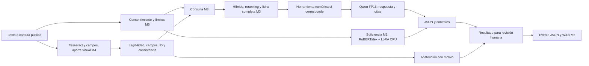

# ContractRisk Colombia: proyecto integrador

**Juan Camilo Ramon y Valentina Castro. SI4006. 19/11/2026.**

[Demo](https://huggingface.co/spaces/Juanoff/contractrisk-colombia) ·
[Run W&B](https://forge.coreweave.com/wandb/jcramonp-eanit/contractrisk-final/runs/f7ljlxip) ·
[Reproducción](REPRODUCIR.md) · [Tablas recalculadas](evidence/delivery_tables/tables.md)

## Problema, usuario y decisión

Una persona analista consulta fichas públicas contractuales y decide si tiene
evidencia suficiente para responder o debe pedir documentos adicionales.
ContractRisk responde con citas, calcula diferencias de valores y lee capturas
rotuladas. El modo M1 señala suficiencia descriptiva. No determina fraude,
autenticidad, cumplimiento físico ni validez jurídica.

La métrica de éxito del usuario es la proporción de consultas resueltas con
respuesta completa, explicación sustentada, citas y abstención adecuada, sin
afirmación crítica inventada. El dominio aproxima esa utilidad:18/22 en OCR final
frente a16/22 del visual FP16 anterior. No medimos ahorro de tiempo del analista
ni exactitud de decisiones legales reales. Cobertura literal no es exactitud.

## Arquitectura y procedencia

M2 aporta eval set/harness de tres dimensiones adaptado a QA e imagen. M5
aporta el ensayo NF4, rechazado, y el servicio observado. [Diagrama completo
editable](ARQUITECTURA.mmd). Sin cálculo no hay herramienta; las guardas pueden
abstenerse antes del LLM. M1 es un modo separado, no verificación de fraude de
cada respuesta. Las capas M1–M3 y métricas originales se conservan. No hubo M4
externo: la pieza visual se incorporó aquí. Las imágenes son fichas sintéticas
rotuladas del snapshot, no contratos firmados ni fotografías probatorias.

## Decisiones técnicas y alternativas

| Componente | Decisión y alternativa descartada |
|---|---|
| M1 | RoBERTalex + LoRA entrenado previamente; inferencia pública en CPU. No sustituirlo por cabeza aleatoria ni detector de fraude. El cargador23 fuerza CPU al leer los mismos pesos y hereda la predicción original. |
| Generador | Qwen2.5-3B-Instruct FP16 con revisión fijada. NF4 perdió demasiada calidad y no se despliega. |
| Recuperación | Híbrido, filtro de ID, reranking y ficha completa para desambiguar contratos/recuperar campos. M3 textual obtuvo7/22 en el conjunto común. El cambio global no se atribuye a una sola pieza. |
| Imagen | TesseractCPU con dos segmentaciones y concordancia de campos. Qwen2-VL falló cinco imágenes legibles del diagnóstico18. Difusión se descarta: se necesita extraer evidencia, no generar documentos. |
| Cálculo | Herramienta determinista con operación y valores trazables. Sin ella hubo explicación numérica incorrecta pese a respuesta corta acertada. |

[Modelos/revisiones](config.py), corpus24 fichas, chunks220/solapamiento30,
identidad de contrato en índice, semilla42, greedy y máximo512 tokens. No hay
fallback silencioso de modelo/precisión. Coincidir con snapshot no autentica imagen.

## Evaluación y misma vara

Conjunto común:12 consultas textuales y10 visuales,22 entradas relacionadas,
no22 contratos independientes ni gold ciego. Las referencias ya se inspeccionaron.
Incluye ausencia de datos/auditoría, instrucción adversarial, blanco y pares de
contraste/rotación. [Protocolo](domain_protocol_v1.json). Todas las filas reciben
las mismas entradas y harness/rúbrica. Dimensiones: cobertura automática de
hechos, juez crudo1–5 y dominio. Dominio exige estructura, abstención, trazabilidad,
criterios humanos de respaldo/completitud, ausencia de crítico y juez≥4.

Gemini4Hydrogen, distinto de Qwen, superó20/20 orientaciones de calibración y12/12
en confirmación para esta configuración. No prueba infalibilidad ni transferencia
a otras tareas. Se conservaron motivos y revisión humana; [rúbrica](RUBRICA_JUEZ_FINAL.md).
En seis pares sintéticos repetir una frase cuatro veces produjo diferencia media
0,5 sin mitigación y0 con ella; no demuestra neutralidad ante longitud legítima.

Comparación02 conservó110 respuestas (cinco perfiles por22), incluidas siete
salidas inválidas del control sin RAG. Evaluación14 obtuvo110 notas sin regenerar
respuestas ni dar gold al juez. Dominio histórico:90 revisiones directas y20
transferencias exactas. El cruce es post-hoc. OCR20 conserva22 respuestas y16
controles; evaluación21 reutiliza14 paquetes idénticos y añade ocho notas, diez
revisiones visuales nuevas y doce textuales transferidas, sin promover notas bajas.

## Evolución y ablación

| Perfil sobre22 entradas | Cobertura literal | Juez /5 | Dominio /22 | Imagen |
|---|---:|---:|---:|---|
| Control QA sin RAG |0,182|3,500|3|No la procesa|
| M3 textual reejecutado |0,280|4,273|7|No la procesa|
| Integrado visual FP16, aporte M4 |0,667|4,364|16|10 entradas|
| Visual NF4, ensayo M5 |0,530|3,773|11|10 entradas|
| FP16 sin herramienta |0,667|4,227|15|10 entradas|
| Final OCR FP16, referencia Colab |0,712|4,455|18|10 entradas,10 cumplen dominio|

El control sin RAG es **adaptación QA**, no el clasificador M2 original
reejecutado. No se mezcla su MacroF1 con QA: limitación de equivalencia estricta
entre módulos. Métricas M3/RAGAS siguen en [su reporte](../m3/README.md), sin
renombrarlas como nuevas. Los textuales se abstienen ante imágenes que no leen:
las notas5 por honestidad no son diez tareas visuales resueltas.

| Perfil | p50 s | p95 s | Pico CUDA asignado GiB |
|---|---:|---:|---:|
| Control sin RAG |2,314|6,410|5,833|
| M3 textual |6,006|10,916|5,879|
| Visual FP16 |7,533|13,367|10,175|
| Visual NF4 |10,750|15,155|6,349|
| FP16 sin herramienta |7,176|13,439|10,175|
| OCR FP16, otra sesión T4* |7,045|11,926|No medido|

Primeras cinco filas: misma sesión TeslaT4, versiones fijadas y carga/calentamiento
separados, una pasada por perfil. *OCR: percentiles descriptivos de wall_seconds
del harness en otra sesión T4, sin calentamiento/sincronización equivalentes.
No demuestra aceleración ni ahorro de memoria; solo las primeras cinco filas
constituyen comparación controlada. No mezclarlas con ZeroGPU/cola pública.
[Tablas y auditoría](evidence/delivery_tables/tables.md).

**Ablación:** con herramienta16/22 y juez4,364; sin herramienta15/22 y4,227.
Veinte salidas idénticas. Las dos respuestas cortas de cálculo son correctas,
pero sin herramienta m3_007 explica16.800.000 frente a168.000.000 en la respuesta.
Con herramienta expone `abs(250000000 - 82000000)` correctamente, juez5 frente a2.
Mejora local de trazabilidad, no ganancia universal de exactitud.

## Eficiencia: generador NF4 antes y después

[Umbrales previos](efficiency_policy.json): pérdida máxima5 puntos de dominio,
ningún crítico nuevo ni retroceso de abstención/adversarial/invarianza, ahorro
mínimo20% de memoria CUDA pico. Solo cambia cuantización del generador.

| Misma sesión T4 y22 casos | Dominio | Juez /5 | p50 s | p95 s | Pico GiB |
|---|---:|---:|---:|---:|---:|
| Antes: visual FP16 |16/22|4,364|7,533|13,367|10,175|
| Después: NF4, cómputo FP16 |11/22|3,773|10,750|15,155|6,349|

252 capas reales de cuatro bits. Memoria−37,60%, mediana+42,70%, dominio−22,73
puntos, un crítico nuevo en m3_001 y dos regresiones de invarianza. Controles
repetidos: no basta conservar un promedio si aparece un crítico. Ambos perfiles
no obedecen la nota adversarial, pero NF4 omite monto y falla completitud.
**NF4 rechazado.** El OCR público conserva FP16, no es una versión eficiente
aceptada. [Decisión reproducible](evidence/domain_review46/scorecard_complete.json).

## Cinco errores, pieza responsable y mejora

| Caso/versión | Fallo | Pieza y mejora propuesta |
|---|---|---|
| m3_003, OCR final | Omite entidad pedida. | Generación: comprobar campos solicitados antes de aceptar salida. |
| m3_005, OCR final | Responde objeto pero no entidad. | Completitud: esquema por campo, sin completar por intuición. |
| m3_006, OCR final | Altera nombre y omite detalles; juez4 pero humano rechaza. | Generación/juez: cotejo semántico y revisión humana; conservar discrepancia. |
| m3_009, OCR final | Llama posterior a2019 frente a firma2024. | Generación temporal: verificador cronológico. |
| vis_04, visual17/18 | Añade cero a250000000 y la guarda bloquea. | Lector: sustituido por OCR acotado, resuelto en20. Es fallo histórico, no del OCR actual. |

Los cuatro primeros persisten. También se conserva redacción imprecisa ante
blanco y continuidad W&B interrumpida. Las mejoras propuestas no se presentan
como implementadas. Un juez4 no salva m3_006: no se ajusta su nota para dominio.
El juez recibe texto, no píxeles. En vis_07 el OCR descarta la instrucción antes
del generador; no demuestra su resistencia. Dos segmentaciones comparten motor,
no son lectores independientes ni confianza calibrada. Formatos/corpus reducidos
limitan generalización. Si falta dato o tipo de fuente, la guarda se abstiene.

## Despliegue y observabilidad

[Demo/repositorio del Space](https://huggingface.co/spaces/Juanoff/contractrisk-colombia/tree/main).
Payload5b42adc35d6e3225c93dfbda13ae2e1730bad1c8: generador, embeddings, reranker,
M1 y TesseractCPU5.5.0, sin VLM ni NF4. El cargador23 fuerza CPU para los mismos
pesos M1 y hereda classify. Colab usó Tesseract5.3.4: coinciden idiomas, no toda
la ejecución. [Acceso sin sesión](evidence/space_ocr23_cpu/ACCESO_PUBLICO.md).

Salud sin GPU: botón, `/healthz` y `/readyz` en
`https://juanoff-contractrisk-colombia.hf.space`. Verifica modelos/OCR/índice;
ready503 indica no listo. Se observó readytrue y real_request_verifiedtrue.
No garantiza cuota futura. Límites: texto1200, descripción8000, imagen10MB/12MP,
concurrencia1 y cola4. Un error no se sustituye por respuesta inventada.

JSON por petición: horaUTC, ID, versión, latencia, éxito/error, componentes y
abstención, sin contenido de entrada. Router y herramienta se distinguen, a
diferencia de un contador histórico corregido sin alterar originales.
[Diez eventos auditados](evidence/space_ocr23_cpu/events_audit.json): siete válidos
exitosos, tres rechazos (dos sin consentimiento, uno M1 vacío). Smoke: texto,
cálculo, legible, dato ausente, blanco, auditoría ausente y M1. No es calidad7/7.

[Run pública](https://forge.coreweave.com/wandb/jcramonp-eanit/contractrisk-final/runs/f7ljlxip):
latencia y flags visibles, versión/job_type comprobados, último summary coincide
con M1. **Figura Crashed**, aunque el Space seguía listo. Causa de interrupción
de heartbeat no resuelta: no declarar monitoreo continuo estable. Los success0
son rechazos de entrada y no se borran. queued_check_dashboard solo significa
encolado. Latencias internas excluyen cola/asignación GPU/red.

La demo no requiere claves pagadas del visitante. Gemini es opcional para notas
nuevas, no inferencia ni recálculo offline. Sin clave del juez, la etapa se
detiene y conserva parciales. Sin WANDB_API_KEY inferencia continúa, telemetría
deshabilitada. Secretos fuera de Git. Presupuesto estimado/reservadoUSD5,9179725
deUSD7, no factura; no liberar reservas desconocidas ni repetir reanudaciones.

## Ética (síntesis)

**A quién puede fallarle más:** formatos sin rótulos, escaneos, texto pequeño y
consultas de varios campos. Medimos omisiones/lecturas en esta muestra, no equidad
entre regiones/entidades. Diferencias poblacionales son hipótesis, no resultados.

**Datos:**24 fichas públicas revisadas y capturas sintéticas. La interfaz exige
consentimiento y prohíbe datos personales. Gradio puede conservar imágenes en
caché temporal con limpieza por antigüedad, no borrado inmediato garantizado.
Logs/W&B guardan metadatos, no pregunta/imagen/OCR. Hosting y acceso público
añaden límites: no cargar documentos privados ni claves. Publicar el proyecto
no equivale a revisar exhaustivamente cada archivo de sus corridas históricas.

**Daño:** inventar auditoría/monto puede perjudicar al contratista y desorientar
al analista. Citas, guardas, consistencia, abstención y advertencia reducen riesgo
sin autenticar. Decisión humana. Confianza M1 no calibrada no es certeza ni fraude.

## Quién hizo qué

**Valentina Castro:** revisó y validó problema/corpus, arquitectura M1/RAG/OCR,
decisiones, FP16/NF4, ablación y alternativas.

**Juan Camilo Ramon:** revisiones humanas, ejecuciones Colab y evidencias;
cuentas/secretos y pruebas de consultas, salud, OCR/M1, W&B y acceso público;
revisión de motivos del juez, errores y límites.

Se conservan firmas de90 revisiones históricas y diez visuales21; las equivalencias
no se convierten en revisiones nuevas. [Contribuciones](CONTRIBUCIONES.md).

## Uso de IA

ChatGPT/Codex y apoyo de Claude en trabajo integrado ayudaron en código,
depuración, notebooks/scripts, pruebas, auditoría/recálculo y redacción. También
se usó IA para diagrama, guion y diapositivas. El equipo validó sus apartados
técnicos; la revisión final de materiales se registra en el checklist. Lectura
técnica de110 motivos y comprobaciones automáticas no se atribuyen como nuevas
revisiones humanas. Se conservan notas crudas, errores y resultados ejecutados.

## Reproducción y cierre

[Guía](REPRODUCIR.md): clonar con historial y recalcular tablas sin GPU/pago;
no se garantiza identidad universal entre entornos. [Presentación/demo](presentacion/GUIA_DEMO.md)
y [checklist](CHECKLIST.md). Quedan revisión humana final y ensayo, coordinación
de sustentación antes del23/11, publicación/merge autorizados y entrega del enlace
en Interactiva con comprobante. Este documento no sustituye la entrega real.
