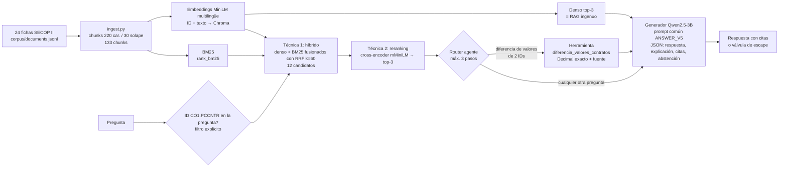

# ContractRisk M3: un RAG que consulta fichas públicas de contratos, calcula y se evalúa

**En palabras sencillas:** ContractRisk responde preguntas de un analista sobre fichas públicas de contratos estatales colombianos (SECOP II), por ejemplo «¿qué se contrata y quién lo contrata?» o «¿cuánto difieren los valores de estos dos contratos?», y siempre dice de qué ficha sacó el dato. Una buena respuesta es correcta, cita la ficha exacta y, si el dato no está en las fichas, lo dice en vez de inventarlo. No decide si un contrato es fraudulento: ayuda a una persona a revisar.

Estado: corrida final sobre el gold ejecutada en Colab T4 y auditada; métricas deterministas recalificadas con `m3-harness-1.1` sobre las mismas respuestas; RAGAS 1.1 preparado y pendiente de ejecutar. **La válvula de escape falla en el sistema final (0/2).** Resultados y lectura honesta: [Resultados](#resultados). Historial de versiones de desarrollo v1–v5: [HISTORIAL_README.md](HISTORIAL_README.md), [CHECKLIST.md](CHECKLIST.md).

## Pipeline

Las cuatro filas comparten generador, revisión, prompt base (`ANSWER_V5`), parámetros de decodificación, corpus e índice. Solo cambian la recuperación y la capa de herramienta.

| Función (`sistemas_m3.py`) | Qué hace |
|---|---|
| `sistema_sin_rag(pregunta)` | Mismo generador y prompt, sin contexto |
| `sistema_rag(pregunta)` | RAG ingenuo S07: denso top-3, con válvula de escape |
| `sistema_rag_avanzado(pregunta)` | Híbrido BM25+denso con RRF y filtro de ID + reranking cross-encoder |
| `sistema_final(pregunta)` | Avanzado + herramienta mediante un agente acotado |

Todas devuelven el mismo registro: `output` (`respuesta`, `explicacion`, `citas`, `abstencion`), contextos entregados al generador, trazas de herramienta e intentos, y `latency_seconds`.

## 1. Corpus e índice

- **Fuente:** [SECOP II – Contratos Electrónicos](https://www.datos.gov.co/Estad-sticas-Nacionales/SECOP-II-Contratos-Electr-nicos/jbjy-vk9h), Colombia Compra Eficiente. Licencia declarada CC BY-SA 4.0; «Fuente: Portal de Datos Abiertos www.datos.gov.co». Detalle en [corpus/README.md](corpus/README.md).
- **Tamaño:** 24 fichas (seis tipos de contrato × 4), 599–1.366 caracteres (mediana ≈ 820), cada una como líneas «campo: valor» (entidad, objeto, modalidad, fechas, valor…). Son fichas de registro, **no** contratos completos: no tienen clausulado ni informes de auditoría. 133 chunks, mediana 5 por ficha.
- **Pipeline:** `prepare_corpus.py` (snapshot congelado y reconstrucción offline con hashes) → `ingest.py` (chunks con offsets y `chunk_id`) → `rag_basic.DenseRetriever` (embeddings + Chroma efímero, reconstruido desde cero en cada corrida) → `retrieval_advanced.py` (BM25, RRF, reranking).

**Las tres decisiones, con argumentos del corpus:**

1. **Chunks de 220 caracteres con 30 de solapamiento.** Nuestras fichas son listas de campos cortos y las preguntas piden uno o dos campos concretos (modalidad, entidad, valor); 220 caracteres agrupan 3–4 campos, de modo que el chunk de «Modalidad» no se diluye con el objeto largo, y caben con el ID antepuesto dentro del límite de 128 tokens del embedding (se verifica sin truncar en cada corrida). El solapamiento de 30 evita perder un campo cortado en la frontera. La propuesta inicial de 800 caracteres dejaba la ficha entera en 1–2 chunks (40 en total), lo que mezcla todos los campos en un vector; no se midió como variante final.
2. **Embeddings `paraphrase-multilingual-MiniLM-L12-v2`.** Las fichas están en español, son de dominio público y deben indexarse en Colab gratis; es multilingüe, pequeño y es el modelo del harness del curso. Antepusimos el ID del contrato al texto embebido porque las preguntas nombran fichas por ID y en smoke v1 muchos chunks no contenían su ID (0/4 fichas correctas en el top-3). Límite observado: el denso no distingue bien números de ID entre fichas casi idénticas (todas comparten la misma plantilla de campos), que es justamente lo que motivó la técnica 1.
3. **top-k = 3 (pool de 12 para fusión y reranking).** Una pregunta toca una o dos fichas de ~5 chunks; 3 chunks bastan para el campo pedido y mantienen corto el prompt del 3B. El pool de 12 cubre todos los chunks de dos fichas, de modo que el reranker puede elegir el chunk exacto.

## 2. Diagnóstico del RAG ingenuo y técnicas avanzadas

El ingenuo (`sistema_rag`, denso top-3) se conserva como fila de comparación. Fallas documentadas en desarrollo (preguntas separadas del gold; [v2](evidence/development_v2/ANALISIS.md), [v5](evidence/integration_v5/ANALISIS.md)):

| Falla observada del ingenuo | Ejemplo real | Tipo | Técnica que la ataca |
|---|---|---|---|
| No llega la ficha pedida: el ID exacto no ancla en el embedding | «¿Qué modalidad registra CO1.PCCNTR.1180445?» trae chunks de 5193000, 3129984 y 4592539 y responde «24 Mes(es)» (0/4 contratos correctos en v2 y v5) | Recuperación (falta el chunk) | **Híbrido BM25 + denso con RRF y filtro explícito de ID**: BM25 ancla el token exacto `co1.pccntr.N`; el filtro restringe a las fichas nombradas en la pregunta (nunca a etiquetas gold) |
| Llega la ficha pero no el campo pedido | Híbrido sin rerank, 1180445: trae la ficha pero no el chunk de modalidad y responde el objeto | Recuperación (mala ordenación) | **Reranking cross-encoder** sobre 12 candidatos: lee pregunta y chunk juntos y sube el chunk con «Modalidad de contratación» |
| Cálculo entre dos fichas sin herramienta | En desarrollo v5 el denso tenía campos de valor, pero de fichas ajenas, y el avanzado traía las fichas correctas sin los campos de valor; ambos produjeron diferencias equivocadas (563637, 1066623) | Recuperación del campo + aritmética | **Herramienta** (sección 3): lee los dos operandos de la ficha y calcula |

Desarrollo v2 (1.5B, mismas cuatro preguntas): denso 0/4, híbrido 3/4, híbrido+rerank 3/4 respuestas correctas, con fragmento correcto recuperado en 0/4, 3/4 y 4/4. En la corrida final se miden además dos **ablaciones** sobre el gold (solo híbrido; denso+rerank) para aislar el efecto de cada técnica.

## 3. Capa agéntica: herramienta `diferencia_valores_contratos`

- **Por qué:** las preguntas de diferencia de valores fallaban por dos motivos: con top-3 los chunks de la ficha correcta a menudo no incluyen el campo de valor, y el generador no calcula de forma fiable. La herramienta resuelve ambos. La herramienta lee el campo «Valor del contrato (COP)» de las dos fichas del snapshot, calcula `abs(a − b)` con `Decimal` y devuelve los dos campos fuente como evidencia citable (`<ID>::tool_value`). No dice nada de sobrecostos.
- **Esquema** (`contract_tools.py`): nombre, descripción y parámetros `id_a`, `id_b` con patrón `^CO1\.PCCNTR\.[0-9]+$`, sin propiedades adicionales.
- **Parseo tolerante pero no ambiguo** (`structured_output.py`, `agent_v4.normalize_decision`): acepta JSON con o sin bloque Markdown y dos variantes observadas inequívocas; rechaza claves duplicadas, nombres desconocidos, IDs que no estén en la pregunta, el mismo ID dos veces y argumentos fuera de esquema. El error vuelve al router como `error_anterior`.
- **Tope:** máximo 3 decisiones del router, llamadas repetidas bloqueadas, presupuesto local de 2 s, una sola respuesta final. Solo lectura: no ejecuta código ni URLs.
- **Cuándo sí y cuándo no:** solo cuando la pregunta pide la diferencia de valores de dos IDs explícitos (gold m3_007 y m3_008). Para modalidad, entidad, cláusulas, auditorías o fechas no hace falta. Las trazas reales (llamada, argumentos, resultado, decisiones sin llamada y llamadas de más) están en `results/final_m3/harness_rows.jsonl` y se resumen en [Resultados](#resultados).

## 4. Evaluación: harness y eval set

- **Eval set** [`eval/gold_v1/eval_set.json`](eval/gold_v1/eval_set.json) (`m3-qa-gold-1.0`, congelado con hash y revisado por Juan Camilo Ramón Pérez el 28/10/2026): 12 casos con `input`, `expected` y `criterion`: 6 de objeto/entidad, 1 de modalidad, 2 de cálculo, 1 de inconsistencia de fechas y **2 sin respuesta en el corpus** (cláusula de multas y auditoría física) donde lo esperado es la válvula de escape. M1 era clasificación, así que se escribieron preguntas nuevas. Nunca se usó para ajustar prompts.
- **Harness** [`harness_m3.py`](harness_m3.py) `harness(eval_set, sistema)`, versión `m3-harness-1.0`, la misma vara para todas las filas, reglas fijadas antes de ejecutar el gold. Tras la revisión del equipo y del profesor se publicó `m3-harness-1.1` ([`harness_m3_v11.py`](harness_m3_v11.py)), que corrige defectos deterministas y **recalifica las mismas respuestas guardadas** (ver [Resultados](#resultados)). El sistema recibe solo el texto de la pregunta.
  - **Dimensión 1 (clásica): cobertura automática de hechos requeridos, 0–1.** No es el porcentaje de respuestas correctas: da crédito parcial (0,5 si aparece uno de dos hechos). Mide la fracción de hechos requeridos del gold que aparecen en respuesta y explicación, normalizando acentos, mayúsculas y separadores de miles. Un hecho cuenta si aparece literal o si aparece el 80 % de sus palabras de 3 o más letras (tolerancia a paráfrasis); las cifras deben ser exactas. En las no respondibles vale 1 si se abstiene. Se informa aparte cuántas respuestas tienen cobertura completa. Sustituye al Macro F1 de M2, que no aplica a respuestas generadas; también se registra la similitud de embeddings de S07 como diagnóstico.
  - **Dimensión 2 (juez):** juez `m3-judge-1.0` ([JUEZ_M3.md](JUEZ_M3.md)) que ve pregunta, respuesta, explicación, citas y evidencia, y **no** ve la referencia ni ningún indicador de acierto. Se corrigió lo señalado en M2: no se reemplaza la nota por «4 si acierta/1 si falla», se promedian solo notas válidas con su cobertura y se conserva todo intento. Se usa sin la instrucción antiverbosidad porque en la calibración v5 (12 pares, 48 juicios) esa instrucción empeoró el efecto de longitud (0,583 → 0,833).
  - **Dimensión 3 (dominio): chequeo automático de dominio.** Es una regla con límites conocidos, no una certificación de que la respuesta sea apta para un analista. Pasa si la cobertura es completa (dim. 1 = 1), cita todas las fichas requeridas, no cita fichas de otro contrato y no acusa fraude. En no respondibles: se abstiene y no afirma cifras. También se exporta la regla de M2 trasladada (exacta y juez ≥ 4).
  - **Latencia:** mediana por consulta desde la pregunta hasta la respuesta final, incluidas recuperación, reranking y herramienta; excluye carga de modelos y juez.
- **RAGAS** [`ragas_m3.py`](ragas_m3.py): **adaptación** de la implementación del laboratorio S10, calculada a mano, no la librería `ragas`. Faithfulness y answer relevancy siguen el laboratorio. Context precision y context recall **no** son las variantes del laboratorio: la 1.0 usa precisión ponderada por rango contra la referencia y recall por segmentos de la referencia. [`ragas_m3_v11.py`](ragas_m3_v11.py) reporta ambas variantes por separado y corrige la segmentación. Juez: el mismo Qwen2.5-3B-Instruct local (preguntas sí/no estrictas); embeddings MiniLM para answer relevancy. Faithfulness (afirmaciones de la respuesta respaldadas por el contexto, incluido el cálculo de la herramienta), answer relevancy (similitud entre la pregunta y la pregunta regenerada desde la respuesta), context precision (precisión media ponderada por rango de los chunks útiles para la referencia; en el laboratorio es la fracción de pasajes relevantes para la pregunta) y context recall (oraciones de la referencia atribuibles al contexto; en el laboratorio es un único sí/no sobre la referencia completa). N/A explícito y con denominador: faithfulness no aplica a abstenciones y las tres restantes no aplican a preguntas sin respuesta en el corpus. Se calcula sobre el ingenuo, el avanzado y el final.

## Resultados

Corrida final: Colab, Tesla T4, 29/10/2026 18:06–18:26 UTC, código `6026ac4`.
- Los **28** hashes de fuentes registrados en `metadata.json` coinciden con el repositorio.
- Se aprobaron 79 pruebas en la sesión y el índice se reconstruyó desde cero (24 fichas, 133 chunks, 16,6 s).
- Evidencia original, conservada sin cambios, en [`results/final_m3/`](results/final_m3/): [`scorecard_m3.csv`](results/final_m3/scorecard_m3.csv), [`ragas_m3.csv`](results/final_m3/ragas_m3.csv), detalle por consulta, respuestas, trazas, juicios y [notebook ejecutado](results/final_m3/ContractRisk_M3_Final_Colab_Ejecutado.ipynb). Revisión caso por caso: [ANALISIS.md](results/final_m3/ANALISIS.md).

**Qué cambió tras la revisión.** La revisión del equipo y del profesor encontró defectos en las reglas automáticas de 1.0:
- una cifra esperada se aceptaba dentro de otra mayor (`168000000` dentro de `1680000000`);
- una mención negada contaba como presencia («no es mínima cuantía»);
- una acusación atenuada no se detectaba («sugiere una posible irregularidad»).

La versión `m3-harness-1.1` los corrige y **recalifica las 72 respuestas guardadas sin regenerarlas**. Las notas del juez son las originales, sin volver a juzgar. Resultado en [`results/final_m3_rescore_v1_1/`](results/final_m3_rescore_v1_1/). Los dos primeros defectos no alteraron ninguna cifra de esta corrida. El tercero cambia el dominio de m3_009 en el avanzado y el final.

### Tabla evolutiva (12 preguntas gold, mismo generador, prompt base y respuestas)

| Sistema | Dim. 1 cobertura de hechos (0-1) | Respuestas con cobertura completa | Dim. 2 juez (1-5) | Dim. 3 chequeo de dominio 1.0 → **1.1** | Latencia mediana (s) |
|---|---:|---:|---:|---:|---:|
| Línea base sin RAG (mismo generador; adaptación de M2) | 0,167 | 2/12 | 2,33 | 2/12 → **2/12** | 6,72 |
| RAG ingenuo (S07): denso top-3 | 0,250 | 3/12 | 3,00 | 3/12 → **3/12** | 8,00 |
| RAG avanzado: híbrido + filtro de ID + reranking | 0,500 | 4/12 | 4,00 | 4/12 → **3/12** | 8,37 |
| **Sistema final: avanzado + herramienta** | **0,611** | **5/12** | **4,17** | 5/12 → **4/12** | **8,86** |
| *Ablación: solo híbrido (sin reranking)* | 0,500 | 3/12 | 3,92 | 3/12 → **3/12** | 7,61 |
| *Ablación: denso + reranking (sin híbrido)* | 0,278 | 3/12 | 3,17 | 3/12 → **3/12** | 7,94 |

Cómo leer la tabla:
- **0,611 no significa 61 % de respuestas correctas.** Es cobertura media de hechos con crédito parcial; solo 5 de 12 respuestas del final tienen cobertura completa.
- La dimensión 3 es un **chequeo automático** con límites. Ni 4/12 ni 5/12 equivalen a «respuestas aptas para un analista» sin revisión humana.
- El juez tiene 12/12 notas válidas en todas las filas, pero dio 4 a una auditoría inventada (m3_012); su calidad semántica no está validada.

### Recuperación: documento correcto frente a dato recuperado

Diagnóstico determinista de `m3-harness-1.1` sobre las 10 preguntas respondibles:

| Sistema | Ficha gold entregada | Todos los hechos requeridos en los fragmentos recuperados | … incluyendo lo que aporta la herramienta |
|---|---:|---:|---:|
| Sin RAG | 0/10 | 0/10 | 0/10 |
| RAG ingenuo | 2/10 | 2/10 | 2/10 |
| Ablación denso + reranking | 6/10 | 2/10 | 2/10 |
| Ablación solo híbrido | 10/10 | 5/10 | 5/10 |
| RAG avanzado | 10/10 | 6/10 | 6/10 |
| Sistema final | 10/10 | 6/10 | **8/10** |

Que la ficha correcta llegue (10/10) demuestra que se **localizó el documento**, no que se recuperó el fragmento que permite responder:
- En los dos cálculos (m3_007, m3_008), el avanzado y el final traen las fichas correctas **sin el campo «Valor del contrato»**.
- En m3_004 y m3_006 la descripción larga queda partida en chunks que no entran completos en el top-3.
- En el final, la herramienta aporta los dos operandos y la operación; ese es el paso de 6/10 a 8/10.

### RAGAS 1.0 (diagnóstico provisional; juez Qwen2.5-3B local)

| Sistema | Faithfulness | Answer relevancy | Context precision (rango, adaptación) | Context recall (segmentos, adaptación) |
|---|---:|---:|---:|---:|
| RAG ingenuo | 0,642 (n=11) | 0,501 (n=10) | 0,033 (n=10) | 0,167 (n=10) |
| RAG avanzado | 0,644 (n=12) | 0,317 (n=10) | 0,350 (n=10) | 0,592 (n=10) |
| Sistema final | 0,708 (n=12) | 0,330 (n=10) | 0,383 (n=10) | 0,792 (n=10) |

Faithfulness excluye abstenciones; las otras tres excluyen las 2 preguntas sin respuesta. Hubo 0 respuestas sí/no sin parsear en 300 llamadas. Limitaciones que impiden usar estas cifras como confirmación de mejora:
- **La segmentación de 1.0 parte `CO1.PCCNTR.<n>` en sus puntos** y crea afirmaciones artificiales, lo que afecta faithfulness.
- **Context precision y context recall son una adaptación**, no las variantes del laboratorio.
- **El juez 3B se equivoca a nivel de fragmento:** dijo «no» a chunks con el dato literal (m3_001, m3_010) y a fechas presentes en la ficha (m3_009). Como sus errores pueden afectar de forma distinta a cada sistema, no se puede asegurar que las diferencias entre filas reflejen tendencias reales.
- **La answer relevancy menor del avanzado no indica peores respuestas.** El ingenuo responde frases genéricas parecidas a la pregunta; el avanzado da respuestas cortas («Mínima cuantía») de las que el juez regenera preguntas desviadas.

**RAGAS 1.1** ([`ragas_m3_v11.py`](ragas_m3_v11.py), [notebook](ContractRisk_M3_RAGAS_v1_1_Colab.ipynb)) corrige la segmentación y reporta por separado la variante exacta del laboratorio y la adaptación, sobre las mismas respuestas guardadas. *Requiere GPU; resultado pendiente de ejecutar en Colab y de conservar junto a 1.0.*

### Lectura honesta

**1. ¿Qué movió qué?**
- **El híbrido con filtro de ID es lo que más movió.** Localiza la ficha pedida en 10/10 casos (2/10 el ingenuo), sube la cobertura de 0,25 a 0,50 y los hechos recuperados completos de 2/10 a 5/10. Ataca la falla diagnosticada: el denso no ancla el ID y responde con fichas ajenas (en m3_002 y m3_005 respondió «CGR – Gerencia Departamental Quindío»). No se separa BM25 del filtro de ID: van juntos.
- **El reranking aportó poco.** Sobre el híbrido, la cobertura queda igual (0,50), los hechos recuperados completos pasan de 5/10 a 6/10, el juez de 3,92 a 4,00 y el dominio 1.1 sigue en 3/12. Sobre el denso sin híbrido, la ficha llega en 6/10 pero el dato completo solo en 2/10. Cuesta unos 0,8 s de mediana.
- **La herramienta movió los cálculos.** Aporta los operandos que la recuperación no traía y hace la aritmética:
  - Sin ella ningún sistema calculó bien (el avanzado tomó referencias como valores: «5147», «19000671 H1 − 19001143A H1»).
  - Con ella, m3_007 y m3_008 dan 168.000.000 y 15.387.424 COP, exactos.
  - m3_007 no tiene cobertura completa porque la explicación dice «sumando las diferencias» y no muestra los operandos.
  - El router decidió `answer` sin herramienta en 9/10 preguntas no aritméticas. **Llamó de más en m3_009** (fechas, un solo ID): dos llamadas inválidas rechazadas y una tercera bloqueada por duplicada, con +6,8 s y sin cambiar la respuesta.
- **Sin RAG** el generador inventa (por ejemplo, «servicio de consultoría técnica» para 1088236, o 51476.7 en el cálculo). El protocolo rechaza las respuestas sin cita (7/12 salidas inválidas) o el sistema se abstiene.

**2. ¿Cuánto costó?**
- Medianas: sin RAG 6,7 s → ingenuo 8,0 s → solo híbrido 7,6 s → avanzado 8,4 s (+0,8 s de reranking) → final 8,9 s (+0,5 s del router).
- En los cálculos, el final tarda 14,1 y 11,4 s frente a 10,6 y 9,0 s del avanzado.
- El reranking es el componente con peor relación costo/beneficio en este corpus.
- El agente es la única fila que obtiene bien los cálculos, a costa de llamadas innecesarias.

**3. ¿Qué falla queda y de qué tipo?** Hay fallas mezcladas, no una sola causa.
- **Recuperación del fragmento (no del documento):** en el final faltan hechos en el contexto en 2/10 respondibles: m3_004 y m3_006, descripciones largas partidas por el chunking de 220 caracteres.
- **Generación con el dato disponible:**
  - entidad omitida (m3_005);
  - objeto parafraseado de forma incompleta (m3_003);
  - explicación errónea de un cálculo correcto (m3_007);
  - en m3_009, «sugiere una posible irregularidad», contra el criterio.
  - En m3_004 y m3_006 la respuesta además confunde el tipo de contrato con el objeto, de modo que se suman recuperación parcial y generación.
- **Medición:** jueces 3B poco fiables; las reglas automáticas, corregidas en 1.1, siguen siendo aproximaciones (por ejemplo, la tolerancia a paráfrasis no controla la negación).
- El contraste con RAGAS va en la misma dirección: el ingenuo tiene context recall bajo (0,17) con faithfulness 0,64, es decir, sigue un contexto que es de otra ficha. Pero con el juez actual esto es indicativo, no concluyente.

**4. ¿Qué pasó con las preguntas sin respuesta en el corpus?** **La válvula no funciona en el sistema final: 0/2.**
- Sin RAG se abstuvo en 2/2, pero se abstiene casi siempre (también en 3 respondibles).
- El ingenuo se abstuvo en m3_012 porque recuperó fichas ajenas, y en m3_011 respondió «registrada: 6 Mes(es)».
- **Avanzado y final, 0/2:**
  - En m3_011 dicen «No se encontró la cláusula de multas…» pero marcan `abstencion=false`.
  - **En m3_012 inventan** «La auditoría de ejecución física concluyó que el contrato… tiene una duración de 4 días», tomando un campo de duración como auditoría. Es el mismo fallo de desarrollo v5.

  Con la ficha correcta del contrato nombrado, el 3B responde con ella aunque no contenga lo pedido; el prompt de la válvula no basta. Siguientes pasos, con una versión y una corrida nuevas, no aplicados retroactivamente:
  - una comprobación posterior que obligue a `abstencion=true` cuando la respuesta niega disponer del dato;
  - que el router reconozca tipos de documento que no existen en el corpus.

**Conclusión.** Es un experimento completo y trazable que muestra mejoras medidas en localización de fichas y en cálculos. **No es un sistema funcional y seguro para uso sin revisión humana**: inventa en una de las dos preguntas sin respuesta y sus métricas automáticas y jueces tienen límites documentados.

**Por qué dejamos el agente:**
- Es la única fila que obtiene correctamente los operandos y el resultado de los cálculos, y mejora las tres dimensiones con +0,5 s de mediana.
- Su costo son las llamadas innecesarias (1/10 preguntas no aritméticas).
- No cambia la falla de abstención.

## Reproducir

En Colab gratuito con GPU T4, sin claves: abrir [ContractRisk_M3_Final_Colab.ipynb](ContractRisk_M3_Final_Colab.ipynb) y ejecutar en orden. Clona la rama, instala [versiones fijadas](requirements-development-v2.txt), corre las pruebas, reconstruye el índice desde cero, ejecuta las seis variantes, el juez y RAGAS, y descarga el ZIP. Modelos con revisión fija (`run_integration_v5.MODELS`): Qwen2.5-3B-Instruct `aa8e725…` (licencia qwen-research), MiniLM `e8f8c21…`, mMiniLM cross-encoder `1427fd6…`. Semilla 42, decodificación greedy. La corrida verifica los hashes del corpus y del gold antes de empezar.

Localmente (sin modelos): `python -m unittest discover -s m3/tests -v`.

## Uso de IA

- **ChatGPT/Codex:** inspección de materiales del curso, planificación, código de corpus, índice, sistemas v1–v5, juez y auditorías técnicas de las corridas de desarrollo (ver [historial](HISTORIAL_README.md)).
- **Claude Code:** harness final de tres dimensiones, implementación de RAGAS del laboratorio S10, módulo de sistemas con ablaciones, script y notebook de la corrida final, pruebas nuevas, borrador de este reporte y lectura de los resultados.
- **El equipo:** definió el proyecto y el dominio, entregó la guía y los materiales S07/S08/S10, revisó y corrigió el gold (Juan Camilo Ramón Pérez, 28/10/2026; corrección de m3_004), ejecutó todas las corridas en Colab y revisó los reportes. *Pendiente de confirmar por los autores antes de entregar: qué partes revisaron o modificaron personalmente.*
- Los modelos que forman parte del sistema (Qwen, MiniLM, cross-encoder) no cuentan como esta declaración.
