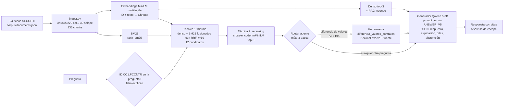

# ContractRisk M3: un RAG que consulta fichas públicas de contratos, calcula y se evalúa

**En palabras sencillas:** ContractRisk responde preguntas de un analista sobre fichas públicas de contratos estatales colombianos (SECOP II), por ejemplo «¿qué se contrata y quién lo contrata?» o «¿cuánto difieren los valores de estos dos contratos?», y siempre dice de qué ficha sacó el dato. Una buena respuesta es correcta, cita la ficha exacta y, si el dato no está en las fichas, lo dice en vez de inventarlo. No decide si un contrato es fraudulento: ayuda a una persona a revisar.

Estado: sistema, harness, RAGAS y corrida final implementados y probados (79 pruebas locales). Resultados de la corrida final sobre el gold: ver [Resultados](#resultados). Historial de versiones de desarrollo v1–v5: [HISTORIAL_README.md](HISTORIAL_README.md), [CHECKLIST.md](CHECKLIST.md).

## Pipeline

Las cuatro filas comparten generador, revisión, prompt base (`ANSWER_V5`), parámetros de decodificación, corpus e índice. Solo cambian la recuperación y la capa de herramienta.

| Función (`sistemas_m3.py`) | Qué hace |
|---|---|
| `sistema_sin_rag(pregunta)` | Mismo generador y prompt, sin contexto |
| `sistema_rag(pregunta)` | RAG ingenuo S07: denso top-3, con válvula de escape |
| `sistema_rag_avanzado(pregunta)` | Híbrido BM25+denso con RRF y filtro de ID + reranking cross-encoder |
| `sistema_final(pregunta)` | Avanzado + herramienta mediante un agente acotado |

Todas devuelven el mismo registro: `output` (`respuesta`, `explicacion`, `citas`, `abstencion`), contextos entregados al generador, trazas de herramienta e intentos, y `latency_seconds`.

## 1. Corpus e índice

- **Fuente:** [SECOP II – Contratos Electrónicos](https://www.datos.gov.co/Estad-sticas-Nacionales/SECOP-II-Contratos-Electr-nicos/jbjy-vk9h), Colombia Compra Eficiente. Licencia declarada CC BY-SA 4.0; «Fuente: Portal de Datos Abiertos www.datos.gov.co». Detalle en [corpus/README.md](corpus/README.md).
- **Tamaño:** 24 fichas (seis tipos de contrato × 4), 599–1.366 caracteres (mediana ≈ 820), cada una como líneas «campo: valor» (entidad, objeto, modalidad, fechas, valor…). Son fichas de registro, **no** contratos completos: no tienen clausulado ni informes de auditoría. 133 chunks, mediana 5 por ficha.
- **Pipeline:** `prepare_corpus.py` (snapshot congelado y reconstrucción offline con hashes) → `ingest.py` (chunks con offsets y `chunk_id`) → `rag_basic.DenseRetriever` (embeddings + Chroma efímero, reconstruido desde cero en cada corrida) → `retrieval_advanced.py` (BM25, RRF, reranking).

**Las tres decisiones, con argumentos del corpus:**

1. **Chunks de 220 caracteres con 30 de solapamiento.** Nuestras fichas son listas de campos cortos y las preguntas piden uno o dos campos concretos (modalidad, entidad, valor); 220 caracteres agrupan 3–4 campos, de modo que el chunk de «Modalidad» no se diluye con el objeto largo, y caben con el ID antepuesto dentro del límite de 128 tokens del embedding (se verifica sin truncar en cada corrida). El solapamiento de 30 evita perder un campo cortado en la frontera. La propuesta inicial de 800 caracteres dejaba la ficha entera en 1–2 chunks (40 en total), lo que mezcla todos los campos en un vector; no se midió como variante final.
2. **Embeddings `paraphrase-multilingual-MiniLM-L12-v2`.** Las fichas están en español, son de dominio público y deben indexarse en Colab gratis; es multilingüe, pequeño y es el modelo del harness del curso. Antepusimos el ID del contrato al texto embebido porque las preguntas nombran fichas por ID y en smoke v1 muchos chunks no contenían su ID (0/4 fichas correctas en el top-3). Límite observado: el denso no distingue bien números de ID entre fichas casi idénticas (todas comparten la misma plantilla de campos), que es justamente lo que motivó la técnica 1.
3. **top-k = 3 (pool de 12 para fusión y reranking).** Una pregunta toca una o dos fichas de ~5 chunks; 3 chunks bastan para el campo pedido y mantienen corto el prompt del 3B. El pool de 12 cubre todos los chunks de dos fichas, de modo que el reranker puede elegir el chunk exacto.

## 2. Diagnóstico del RAG ingenuo y técnicas avanzadas

El ingenuo (`sistema_rag`, denso top-3) se conserva como fila de comparación. Fallas documentadas en desarrollo (preguntas separadas del gold; [v2](evidence/development_v2/ANALISIS.md), [v5](evidence/integration_v5/ANALISIS.md)):

| Falla observada del ingenuo | Ejemplo real | Tipo | Técnica que la ataca |
|---|---|---|---|
| No llega la ficha pedida: el ID exacto no ancla en el embedding | «¿Qué modalidad registra CO1.PCCNTR.1180445?» trae chunks de 5193000, 3129984 y 4592539 y responde «24 Mes(es)» (0/4 contratos correctos en v2 y v5) | Recuperación (falta el chunk) | **Híbrido BM25 + denso con RRF y filtro explícito de ID**: BM25 ancla el token exacto `co1.pccntr.N`; el filtro restringe a las fichas nombradas en la pregunta (nunca a etiquetas gold) |
| Llega la ficha pero no el campo pedido | Híbrido sin rerank, 1180445: trae la ficha pero no el chunk de modalidad y responde el objeto | Recuperación (mala ordenación) | **Reranking cross-encoder** sobre 12 candidatos: lee pregunta y chunk juntos y sube el chunk con «Modalidad de contratación» |
| Cálculo entre dos fichas sin herramienta | Denso/avanzado v5 producen diferencias equivocadas (563637, 1066623) aun con ambos valores en contexto | Generación (aritmética) | **Herramienta** (sección 3) |

Desarrollo v2 (1.5B, mismas cuatro preguntas): denso 0/4, híbrido 3/4, híbrido+rerank 3/4 respuestas correctas, con fragmento correcto recuperado en 0/4, 3/4 y 4/4. En la corrida final se miden además dos **ablaciones** sobre el gold (solo híbrido; denso+rerank) para aislar el efecto de cada técnica.

## 3. Capa agéntica: herramienta `diferencia_valores_contratos`

- **Por qué:** las preguntas de diferencia de valores fallaban por aritmética del generador, no por recuperación. La herramienta lee el campo «Valor del contrato (COP)» de las dos fichas del snapshot, calcula `abs(a − b)` con `Decimal` y devuelve los dos campos fuente como evidencia citable (`<ID>::tool_value`). No dice nada de sobrecostos.
- **Esquema** (`contract_tools.py`): nombre, descripción y parámetros `id_a`, `id_b` con patrón `^CO1\.PCCNTR\.[0-9]+$`, sin propiedades adicionales.
- **Parseo tolerante pero no ambiguo** (`structured_output.py`, `agent_v4.normalize_decision`): acepta JSON con o sin bloque Markdown y dos variantes observadas inequívocas; rechaza claves duplicadas, nombres desconocidos, IDs que no estén en la pregunta, el mismo ID dos veces y argumentos fuera de esquema. El error vuelve al router como `error_anterior`.
- **Tope:** máximo 3 decisiones del router, llamadas repetidas bloqueadas, presupuesto local de 2 s, una sola respuesta final. Solo lectura: no ejecuta código ni URLs.
- **Cuándo sí y cuándo no:** solo cuando la pregunta pide la diferencia de valores de dos IDs explícitos (gold m3_007 y m3_008). Para modalidad, entidad, cláusulas, auditorías o fechas no hace falta. Las trazas reales (llamada, argumentos, resultado, decisiones sin llamada y llamadas de más) están en `results/final_m3/harness_rows.jsonl` y se resumen en [Resultados](#resultados).

## 4. Evaluación: harness y eval set

- **Eval set** [`eval/gold_v1/eval_set.json`](eval/gold_v1/eval_set.json) (`m3-qa-gold-1.0`, congelado con hash y revisado por Juan Camilo Ramón Pérez el 28/10/2026): 12 casos con `input`, `expected` y `criterion`: 6 de objeto/entidad, 1 de modalidad, 2 de cálculo, 1 de inconsistencia de fechas y **2 sin respuesta en el corpus** (cláusula de multas y auditoría física) donde lo esperado es la válvula de escape. M1 era clasificación, así que se escribieron preguntas nuevas. Nunca se usó para ajustar prompts.
- **Harness** [`harness_m3.py`](harness_m3.py) `harness(eval_set, sistema)`, versión `m3-harness-1.0`, la misma vara para todas las filas, reglas fijadas antes de ejecutar el gold. El sistema recibe solo el texto de la pregunta.
  - **Dimensión 1 (clásica): exactitud verificable 0–1.** Fracción de hechos requeridos del gold presentes en la respuesta (normalizando acentos, mayúsculas y separadores de miles; paráfrasis aceptada si aparece el 80 % de las palabras, cifras siempre exactas). En las no respondibles vale 1 si se abstiene. Sustituye al Macro F1 de M2, que no aplica a respuestas generadas; también se registra la similitud de embeddings de S07 como diagnóstico.
  - **Dimensión 2 (juez):** juez `m3-judge-1.0` ([JUEZ_M3.md](JUEZ_M3.md)) que ve pregunta, respuesta, explicación, citas y evidencia, y **no** ve la referencia ni ningún indicador de acierto. Se corrigió lo señalado en M2: no se reemplaza la nota por «4 si acierta/1 si falla», se promedian solo notas válidas con su cobertura y se conserva todo intento. Se usa sin la instrucción antiverbosidad porque en la calibración v5 (12 pares, 48 juicios) esa instrucción empeoró el efecto de longitud (0,583 → 0,833).
  - **Dimensión 3 (dominio): respuesta utilizable por el analista.** Pasa si es exacta (dim. 1 = 1), cita todas las fichas requeridas, no cita fichas de otro contrato y no acusa fraude. En no respondibles: se abstiene y no afirma cifras. También se exporta la regla de M2 trasladada (exacta y juez ≥ 4).
  - **Latencia:** mediana por consulta desde la pregunta hasta la respuesta final, incluidas recuperación, reranking y herramienta; excluye carga de modelos y juez.
- **RAGAS** [`ragas_m3.py`](ragas_m3.py): implementación del **laboratorio S10**, calculada a mano, no la librería `ragas`. Juez: el mismo Qwen2.5-3B-Instruct local (preguntas sí/no estrictas); embeddings MiniLM para answer relevancy. Faithfulness (afirmaciones de la respuesta respaldadas por el contexto, incluido el cálculo de la herramienta), answer relevancy (similitud entre la pregunta y la pregunta regenerada desde la respuesta), context precision (precisión media ponderada por rango de los chunks útiles para la referencia) y context recall (oraciones de la referencia atribuibles al contexto). N/A explícito y con denominador: faithfulness no aplica a abstenciones y las tres restantes no aplican a preguntas sin respuesta en el corpus. Se calcula sobre el ingenuo, el avanzado y el final.

## Resultados

<!-- RESULTADOS_FINALES: se completa con results/final_m3 de la corrida Colab T4 -->
**Pendiente de la corrida final en Colab T4** ([notebook](ContractRisk_M3_Final_Colab.ipynb)). Las tablas se generan con `python m3/report_m3.py m3/results/final_m3` a partir del detalle por consulta.

## Reproducir

En Colab gratuito con GPU T4, sin claves: abrir [ContractRisk_M3_Final_Colab.ipynb](ContractRisk_M3_Final_Colab.ipynb) y ejecutar en orden. Clona la rama, instala [versiones fijadas](requirements-development-v2.txt), corre las pruebas, reconstruye el índice desde cero, ejecuta las seis variantes, el juez y RAGAS, y descarga el ZIP. Modelos con revisión fija (`run_integration_v5.MODELS`): Qwen2.5-3B-Instruct `aa8e725…` (licencia qwen-research), MiniLM `e8f8c21…`, mMiniLM cross-encoder `1427fd6…`. Semilla 42, decodificación greedy. La corrida verifica los hashes del corpus y del gold antes de empezar.

Localmente (sin modelos): `python -m unittest discover -s m3/tests -v`.

## Uso de IA

- **ChatGPT/Codex:** inspección de materiales del curso, planificación, código de corpus, índice, sistemas v1–v5, juez y auditorías técnicas de las corridas de desarrollo (ver [historial](HISTORIAL_README.md)).
- **Claude Code:** harness final de tres dimensiones, implementación de RAGAS del laboratorio S10, módulo de sistemas con ablaciones, script y notebook de la corrida final, pruebas nuevas, borrador de este reporte y lectura de los resultados.
- **El equipo:** definió el proyecto y el dominio, entregó la guía y los materiales S07/S08/S10, revisó y corrigió el gold (Juan Camilo Ramón Pérez, 28/10/2026; corrección de m3_004), ejecutó todas las corridas en Colab y revisó los reportes. *Pendiente de confirmar por los autores antes de entregar: qué partes revisaron o modificaron personalmente.*
- Los modelos que forman parte del sistema (Qwen, MiniLM, cross-encoder) no cuentan como esta declaración.
